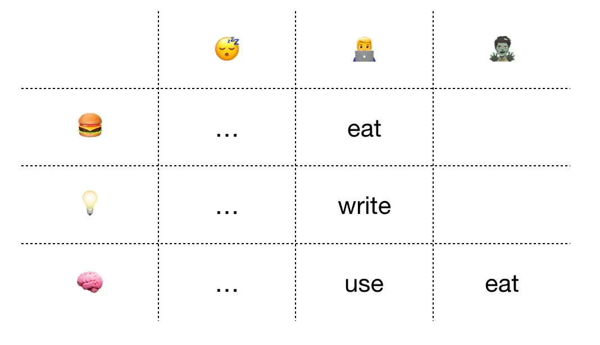

<div align="center">
  <h1>🤖 Faste 💡</h1>
  TypeScript centric Table Finite State Machine
  <br/>
  
  <br/>
  <br/>
  <a href="https://github.com/theKashey/faste/actions/workflows/ci.yml">
   
  </a>

  <a href="https://github.com/theKashey/faste/actions">
   
  </a>

  <a href="https://www.npmjs.com/package/faste">
   
  </a>

  <br/>
  <br/>
  <br/>  
</div>

> no dependencies, in around 2kb

- 👨‍🔬 a bit less state-ish than [xstate](https://xstate.js.org/docs/)
- 🤖 way more state-full than anything else in your code
- 🧠 made for everything in between
- 🖥 it does not have Visualizer, but it's VERY TypeScript centric

State machine is a blackbox you can 1) `.start` 2) `.put` some events in and 3) _observe_ how its working.

Internally it will be a machine working in different "states", which called **phases** here (water/ice) recieving
different events and doing something...

Core concepts are:

- phases: different modes your machine can be in
- state: internal state machine sets and controls itself
- attributes: external configuration of machine
- messages: events it can receive from the outside or send to itself
- signals: events it can send to the outer world
- timers: in a very declarative form
- hooks: callbacks which are executed when machine start or stop handling a given message
- guards and traps: protectors from entering or leaving some states

> In react world `attributes` are `props`. In xstate world `state` is `context`

# Install

```bash
npm install faste
```

# State machine

State machine _starts_ in one phase, calls _hooks_ for all _messages_ for the current phase,
then _awaits_ for a _messages_ from hooks or external customer, then
could _trigger_ a new message, _emit_ signal to the outer world or _change_ the current phase.

Faste is a black box - you can _put_ message inside, and wait for a _signal_ it will sent outside, meanwhile
observing a box _phase_. Black📦 == Component🎁.

📖 Read an article about [FASTE, and when to use it](https://medium.com/@antonkorzunov/fasten-your-state-9fb9f9b44f30).

# Example

```js
const light = faste()
  // define possible "phases" of a traffic light
  .withPhases(['red', 'yellow', 'green'])
  // define possible transitions from one phase to another
  .withTransitions({
    green: ['yellow'],
    yellow: ['red'],
    red: ['green'],
  })
  // define possible events for a machine
  .withMessages(['switch'])
  .on('switch', ['green'], ({ transitTo }) => transitTo('yellow'))
  .on('switch', ['yellow'], ({ transitTo }) => transitTo('red'))
  .on('switch', ['red'], ({ transitTo }) => transitTo('green'))
  // ⚠️ TypeScript refuses the following line: `withTransitions` has no green -> red
  .on('switch', ['green'], ({ transitTo }) => transitTo('red'))

  // block transition TO green if any pedestrian is on the road
  .guard(['green'], () => noPedestriansOnTheRoad)
  // block transition FROM red if any pedestrian is on the road
  .trap(['red'], () => !noPedestriansOnTheRoad);
// PS: noPedestriansOnTheRoad could be read from attrs, passed from a higher state machine.
```

`withTransitions` is a compile-time restriction only. Nothing checks it at runtime, so JavaScript code, or a cast, can
still make the blocked transition. `guard` and `trap` are the runtime checks.

# Messages and signals

Messages come in, signals go out. `put` sends a message to the machine, and `trigger` lets a handler send one to the
machine itself. `emit` sends a signal to whatever `connect` attached.

```js
const door = faste()
  .withPhases(['open', 'closed'])
  .withMessages(['push'])
  .withSignals(['opened'])
  .on('push', ['closed'], ({ transitTo, emit }) => {
    transitTo('open');
    emit('opened');
  })
  .create();

door.connect((signal) => console.log(signal));
door.start('closed');
door.put('push'); // logs "opened"
```

More in [examples](./docs/examples.md), including async handlers and timers. [Design](./docs/design.md) says where the
idea came from.

# API

## Machine blueprint

`faste()` - defines a new faste machine
every faste instance provide next _chainable_ commands

- `on(eventName, [phases], callback)` - set a hook `callback` for `eventName` message in states `states`.
- `hooks(hooks)` - set a hook when some message begins, or ends its presence.

- `guard(phases, callback)` - add a transition guard, prevention transition to the phase
- `trap(phases, callback)` - add a transition guard, prevention transition from the phase
- `scope(callback)` - runs `callback` with the builder, to reuse logic among machines

In development mode, and for typed languages you could use next commands

- `withState(state)` - set a initial state (use @init hook to derive state from props).
- `withPhases(phases)` - limit phases to provided set.
- `withTimers(timersConfuguration)` - configures timers
- `withTransitions([phases]:[phases])` - limit phase transitions, at compile time only
- `withMessages(messages)` - limit messages to provided set.
- `withAttrs(attributes)` - limit attributes to provided set.
- `withSignals(signals)` - limit signals to provided set.
- `withAsyncSignals()` - deliver signals asynchronously

- `withMessageArguments<MessageConfiguration>()` - enabled arguments for messages
- `withSignalArguments<SignalConfiguration>()` - enabled arguments for signals

- `create()` - creates a machine (copies existing, use it instead of `new`).

All methods returns a `faste` constructor itself.

## Machine instance

Each instance of Faste will have:

- `attrs(attrs)` - set attributes.
- `put` - put message in
- `connect` - connects output to the destination
- `observe` - observes phase changes

- `phase` - returns the current phase
- `instance` - returns the current internal state.

- `destroy` - terminates all hooks and timers, drops queued messages, and stops the machine. It runs no `@leave`, and
  `phase` keeps answering the last phase.
- `start` - after `destroy`, begins a new run with a full entry: `@init`, `@enter`, hooks and observers, from no phase.
  State, attributes, observers and connections stay. Whatever the earlier run created (an instance, a callback a hook
  kept, a pending async signal) does nothing any more.

- `namedBy(string)` - sets name of the instance (for debug).

For all callbacks the first argument is `flow` instance, containing.

- `attrs` - all the attrs, you cannot change them

- `state` - internal state
- `setState` - internal state change command

- `phase` - current phase
- `transitTo` - phase change command.

- `startTimer(timerName)` - starts a Timer
- `stopTimer(timerName)` - stops a Timer

- `emit` - emits a message to the outer world

### Magic events

- `@init` - on initialization
- `@enter` - on phase enter, last phase will be passed as a second arg.
- `@leave` - on phase leave, new phase will be passed as a second arg.
- `@change` - on state change, old state will be passed as a second arg.
- `@miss` - on event without handler
- `@error` - an error handler. If no errors handler will be found the real error will be thrown

### Magic phases

- `@current` - set the same phase as it was on the handler entry
- `@busy` - set the _busy_ phase, when no other handler could be called. Messages are queued until it ends
- `@locked` - like `@busy`, but messages are ignored

### Hooks

Hook activates when message starts or ends it existence, ie when there is `on` callback defined for it.

### Event bus

- message handler could change phase, state and trigger a new message
- hook could change state or trigger a new message, but not change phase
- external consumer could only trigger a new message

## InternalState

Each `on` handler or hook will receive `internalState` as a first argument, with following shape

```js
attrs; // attributes
state; // state
phase; // current phase
message; // the message being handled

setState(newState); // setState (as seen in React)
transitTo(phase); // move to a new phase
emit(signal, ...args); // emit Signal to the outer world (connected)
trigger(message, ...args); // trigger own message handler (dispatch an internal action)
startTimer(timerName); // starts a Timer
stopTimer(timerName); // stops a Timer
```

# Debug

Debug mode is integrated into Faste.

```js
import { setFasteDebug } from 'faste';

setFasteDebug(true);
setFasteDebug((instance, message, args) => console.log(...));
```

# Prior art

This library combines ideas from [xstate](https://github.com/davidkpiano/xstate)
and [redux-saga](https://github.com/redux-saga/redux-saga).
The original idea is based on [xflow](https://gist.github.com/theKashey/93f10d036961f4bd7dd728153bc4bea9) state machine,
developed for [CT Company](http://www.ctcom.com.tw)'s VoIP solutions back in 2005.

# Releasing

1. Bump `version` in `package.json` and commit it.
2. Tag that commit `v<version>`, for example `git tag v2.0.1`.
3. Push the commit and the tag: `git push origin master v2.0.1`.

The tag starts [`release.yml`](.github/workflows/release.yml). It refuses a tag that differs from `package.json`, then
builds, tests and publishes with provenance. No npm token is stored in the repository.

One-time setup on npmjs.com: open the package's Settings, find Trusted Publisher, choose GitHub Actions, and enter
owner `theKashey`, repository `faste`, workflow filename `release.yml`.

# Licence

MIT
