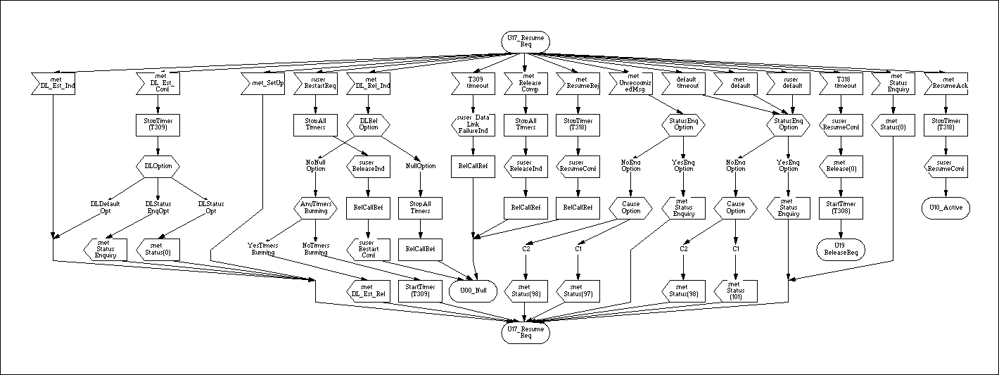

# Design

## SDL and Block

Faste was born from this. From Q.931(EDSS) state definition.

How it starts. What signals it accepts. What it does next.

That is quite simple diagram.

## Thoughts

This is a Finite State Machine from
SDL([Specification and Description Language](https://en.wikipedia.org/wiki/Specification_and_Description_Language))
prospective.
SDL defines state as a set of messages, it should react on, and the actions beneath.

Once `state` receives a `message` it executes an `action`, which could perform calculations and/or change the
current state.

> The goal is not to **change the state**, but - **execute a bound action**.
> From this prospective faste is closer to RxJX.

Usually "FSM" are more focused on state transitions, often even omitting any operations on message receive.
In the Traffic Light example it could be useful, but in more real life examples - probably not.

Faste is more about _when_ you will be able to do _what_. **What** you will do, **when** you receive event, and what you
will do next.

Keeping in mind the best practices, like KISS and DRY, it is better to invert state->message->action connection,
as long as actions are most complex part of it, and messages are usually reused across different states.

And, make things more common we will call "state" as a "phase", and "state" will be for "internal state".

The key idea is not about transition between states, but transition between behaviors.
Keep in mind - if some handler is not defined in some state, and you are sending a message - it will be **lost**.

> Written in TypeScript. To make things less flexible. Flow definitions as incomplete.
